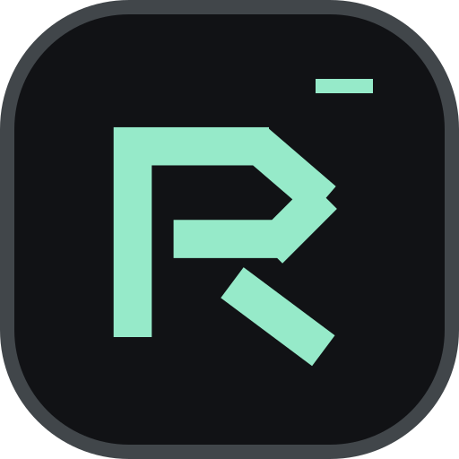

# Ryou UI

Biblioteca de interfaz para Roblox Studio. **V14.0.0 · Created by Ryou**

Ryou UI ofrece una ventana redimensionable, navegación lateral, controles táctiles y de mouse, temas y notificaciones. El símbolo y los iconos incluidos se dibujan con elementos de Roblox. La biblioteca funciona como `ModuleScript` de cliente.

## Inicio rápido

1. Crea un `ModuleScript` llamado `RyouUI` en `ReplicatedStorage` y coloca ahí el contenido de [ui/RyouUI.lua](ui/RyouUI.lua).
2. En `StarterPlayer > StarterPlayerScripts`, crea un `LocalScript` con este ejemplo.
3. Pulsa **Play** en Studio. Pulsa **Shift derecho** para abrir o cerrar la ventana.

```lua
local storage = game:GetService("ReplicatedStorage")
local UI = require(storage:WaitForChild("RyouUI"))
local window = UI:CreateWindow({Title = "Ryou UI", Subtitle = "Demostración"})
local home = window:Tab({Title = "Inicio", Icon = "home"})
home:Button({
    Title = "Mostrar aviso",
    Callback = function()
        window:Notify({Type = "success", Title = "Todo listo"})
    end,
})
```

El [proyecto Rojo](default.project.json) monta el mismo módulo con el ejemplo completo. La [guía de instalación](docs/getting-started.md) incluye ambas rutas.

## Controles y personalización

| Interfaz | Cómo empezar |
| --- | --- |
| Ventana, launcher arrastrable, grupos de pestañas | [Ventanas](docs/windows.md) · [Pestañas](docs/tabs.md) |
| Botón, interruptor, slider, texto y selector de color | [Componentes](docs/components.md) |
| Dropdown inline individual o múltiple | [Dropdowns](docs/dropdowns.md) |
| Iconos nativos e imágenes de Roblox | [Catálogo visual](branding/icons.svg) · [Iconos](docs/icons.md) |
| Temas oscuros y claros, acento y espaciado | [Temas](docs/themes.md) · [Personalización](docs/customization.md) |
| Entrada escalonada, movimiento reducido y avisos | [Movimiento](docs/animations.md) · [Notificaciones](docs/notifications.md) |

[API de referencia](docs/api-reference.md) · [Migración](docs/migration.md) · [Solución de problemas](docs/troubleshooting.md) · [English quickstart](docs/getting-started-en.md)

## Ejemplos y verificación

[Ventana mínima](examples/Minimal.client.lua) · [Interfaz completa](examples/Complete.client.lua) · [Iconos](examples/Icons.client.lua) · [Temas](examples/Themes.client.lua) · [Movimiento](examples/Motion.client.lua) · [Responsive](examples/Responsive.client.lua) · [Notificaciones](examples/Notifications.client.lua) · [Integración](examples/Integration.client.lua) · [Galería de outfits](examples/Outfits.client.lua)

La interfaz está diseñada para cliente de Roblox con mouse o pantalla táctil. La revisión de V14 incluye compilación con Luau y una [prueba de humo para Studio](tests/Smoke.client.lua). La validación de interacción y las capturas de producto se registran siguiendo el [plan de pruebas](docs/testing.md).

## Proyecto

[Historial de cambios](CHANGELOG.md) · [Contribuir](CONTRIBUTING.md)

El punto de entrada de V14 es `ui/RyouUI.lua`. El historial de compatibilidad y los builds anteriores siguen en sus rutas de origen. La licencia para redistribuir V14 está pendiente de aprobación y revisión de procedencia. Consulta [alcance y atribución](docs/provenance.md).
