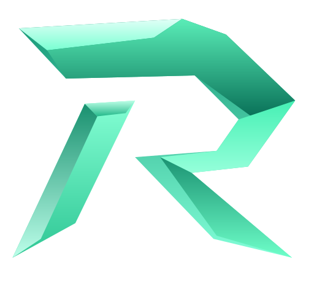

<div align="center">
  
  <h1>Ryou UI</h1>
  <p>Biblioteca visual de un archivo para scripts Luau de cliente Roblox.</p>
  <p><strong>14.0.0 · Neo Sidebar</strong> · Rama de revisión · Created by Ryou</p>
</div>


*Referencia 01 del paquete Neo Sidebar. Mockup conceptual. Las capturas ejecutadas en Roblox están pendientes.*

[Showcase interactivo](ryou-ui-v14/examples/NeoShowcase.lua) · [Guía visual y recursos](ryou-ui-v14/docs/neo-sidebar.md) · [Matriz de QA](ryou-ui-v14/docs/neo-qa.md)

## Empieza aquí

- [Descarga el archivo Luau](ryou-ui-v14/RyouUI.lua) y sigue la [instalación](ryou-ui-v14/docs/getting-started.md).
- [Getting started in English](ryou-ui-v14/docs/getting-started.en.md).
- [Ejemplos ejecutables](ryou-ui-v14/examples/) y [referencia de API](ryou-ui-v14/docs/api-reference.md).
- [Catálogo gráfico](ryou-ui-v14/assets/icon-catalog.svg), [temas](ryou-ui-v14/docs/themes.md) y [movimiento](ryou-ui-v14/docs/animations.md).

```lua
local UI = require(script.Parent:WaitForChild("RyouUI"))
local window = UI:CreateWindow({ Title = "Mi panel" })
local home = window:Tab({ Title = "Inicio", Icon = "home" })
home:Button({ Title = "Estado", Callback = function()
    window:Notify({ Type = "success", Title = "Panel activo" })
end })
```

## Compatibilidad

El archivo devuelve la biblioteca visual. Puede cargarse como ModuleScript o mediante el [cargador dinámico](ryou-ui-v14/examples/DynamicLoader.lua) donde el host provea las capacidades documentadas. Requiere servicios de cliente Roblox. La [guía de migración](ryou-ui-v14/docs/migration.md) indica las firmas de V12 compatibles y las diferencias.

La [prueba de estado](ryou-ui-v14/tests/) corre en Luau CLI. Las capturas y la verificación táctil quedan pendientes de ejecución en el cliente.

[Contribuir](ryou-ui-v14/CONTRIBUTING.md) · [Historial de cambios](ryou-ui-v14/CHANGELOG.md) · [Licencia MIT de Ryou UI](ryou-ui-v14/LICENSE) · [Contexto histórico del repositorio](PROJECT_CONTEXT.md)
