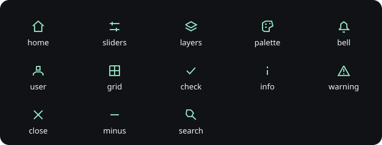

# Iconos



| Categoría | Nombres |
| --- | --- |
| Navegación | `home`, `sliders`, `layers`, `palette`, `bell`, `user`, `grid` |
| Estados | `check`, `info`, `warning`, `close` |
| Utilidad | `minus`, `search` |
| Alias | `settings`, `sliders-horizontal`, `layout-grid`, `badge-info`, `shirt` |

En pestañas, el icono mide 18 px. Los controles usan 16 px por defecto y admiten `IconSize` de 10 a 24. El icono de la pestaña activa usa el acento del tema. Un nombre desconocido en la navegación usa la inicial del título. Un control con nombre desconocido muestra un trazo mínimo.

Para usar una imagen, sube un PNG monocromático con transparencia como asset de Roblox, autoriza su uso en la experiencia y registra su ID desde el cliente.

```lua
local id = script:GetAttribute("IconAssetId")
if type(id) == "number" and id >= 1 and id % 1 == 0 then
    UI:RegisterIcon("proyecto", id)
    tab:Button({Title = "Abrir proyecto", Icon = "proyecto", IconSize = 20})
end
```

`Icon` también acepta directamente un número o un URI `rbxassetid://`. El color se aplica como tinte en ambas modalidades. Las imágenes dependen de moderación, permisos y carga del cliente. `UI:GetIconAsset(name)` devuelve un URI registrado o `nil` para iconos nativos, que no tienen asset asociado. Los archivos históricos de `icons/` no son el catálogo que carga V14.
