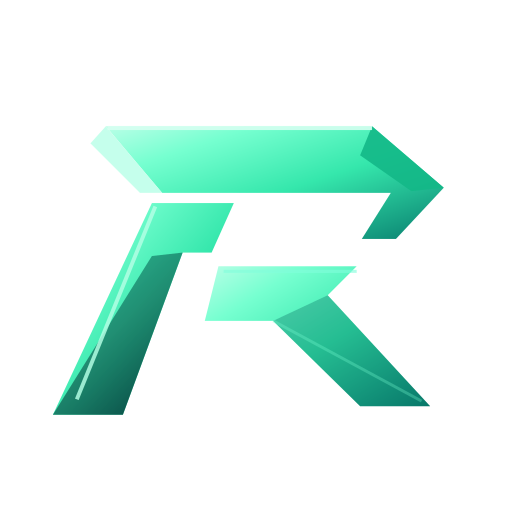
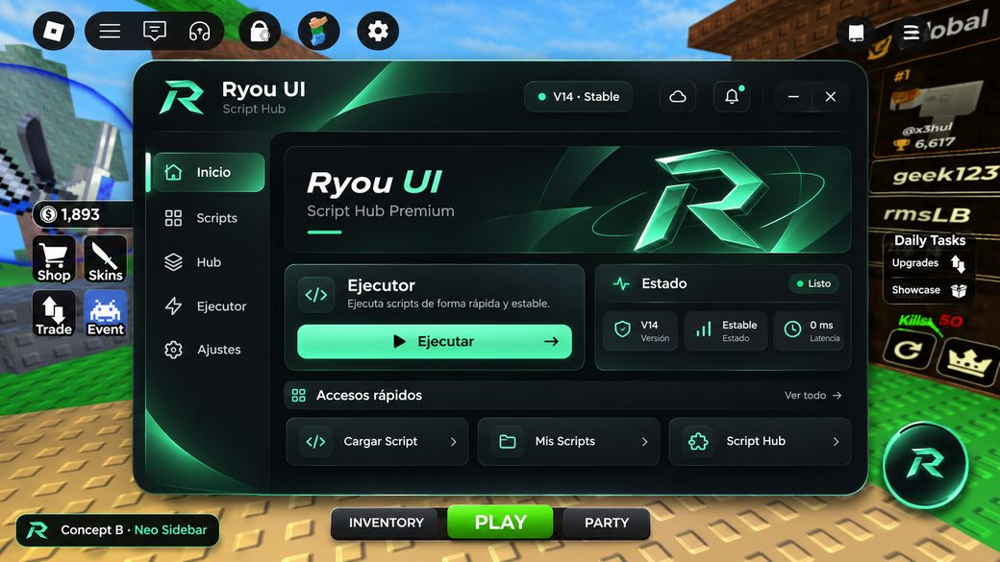

<div align="center">
  
  <h1>Ryou UI</h1>
  <p>Biblioteca visual en un archivo para scripts Luau de cliente Roblox.</p>
  <p><strong>14.0.0 · Neo Sidebar V4</strong> · Rama de revisión · Created by Ryou</p>
</div>



*Referencia 01 del paquete Neo Sidebar. Mockup conceptual. Las capturas ejecutadas en Roblox están pendientes.*

[Showcase interactivo](examples/NeoShowcase.lua) · [Guía visual y recursos](docs/neo-sidebar.md) · [Matriz de QA](docs/neo-qa.md)

[Inicio rápido](docs/getting-started.md) · [English](docs/getting-started.en.md) · [API](docs/api-reference.md) · [Ejemplos](examples/) · [Cambios](CHANGELOG.md)

Ryou UI reúne ventanas, navegación lateral adaptable, controles de formulario y avisos. La paleta usa negro carbón con acento menta. El monograma facetado, el halo y las demás capas de marca se cargan desde [los PNG V3](assets/neo/manifest.json). Los [SVG editables](assets/neo/source/) vienen con el paquete.

## Instalación rápida

Usa [RyouUI.lua](RyouUI.lua) como módulo del cliente. En Studio puedes copiar el archivo a un `ModuleScript` y cargarlo desde un `LocalScript` hermano. En hosts que proveen lectura HTTPS y compilación Luau, consulta el [cargador dinámico](examples/DynamicLoader.lua). Ambos puntos de entrada cargan el mismo archivo.

```lua
local UI = require(script.Parent:WaitForChild("RyouUI"))
local window = UI:CreateWindow({ Title = "Mi panel" })
local home = window:Tab({ Title = "Inicio", Icon = "home" })
home:Button({ Title = "Estado", Callback = function()
    window:Notify({ Type = "success", Title = "Panel activo" })
end })
```

## Showcase Neo Sidebar V4

Ejecuta este bloque en el cliente compatible. Abre el showcase con las superficies, los controles compactos y el arte de Neo Sidebar V4.

```lua
local base = "https://raw.githubusercontent.com/vryex/ryouhub/1d83ea02929281d67caf0aecd301376811656ea2/ryou-ui-v14/"
local UI = assert(loadstring(game:HttpGet(base .. "RyouUI.lua")))()
local mount = assert(loadstring(game:HttpGet(base .. "examples/NeoShowcase.lua")))()
mount(UI, { Motion = "Full" })
```

`RyouUI.lua` descarga los PNG por HTTPS desde el commit de arte indicado en el [manifiesto](assets/neo/manifest.json). Valida firma y tamaño, guarda los bytes con `writefile` en `RyouUI/Cache/<versión>/` y registra el archivo con `getcustomasset` o `getsynasset`. Las imágenes aparecen en segundo plano y las aperturas siguientes reutilizan el identificador o el archivo en disco. El cliente usa nombres versionados en la raíz si las carpetas están indisponibles.

En Studio y en clientes sin esas API, abre la misma interfaz con una R tipográfica y controles nativos. La consola indica cuándo el arte personalizado está indisponible. Consulta la [guía de carga](docs/neo-sidebar.md#arte-de-github-y-caché) para más detalles.

## Documentación

| Para hacer esto | Consulta |
| --- | --- |
| Crear, mover y redimensionar | [Ventanas](docs/windows.md) |
| Navegar y organizar la interfaz | [Pestañas](docs/tabs.md) |
| Crear botones, toggles, sliders, inputs y colorpickers | [Componentes](docs/components.md) |
| Implementar búsqueda, listas dinámicas o selección múltiple | [Dropdowns](docs/dropdowns.md) |
| Elegir un glifo o cargar uno propio | [Catálogo gráfico](assets/icon-catalog.svg) y [guía de iconos](docs/icons.md) |
| Cambiar tema, tipografía y movimiento | [Temas](docs/themes.md), [Personalización](docs/customization.md) y [Animaciones](docs/animations.md) |
| Mostrar mensajes de estado | [Notificaciones](docs/notifications.md) |
| Instalar en un proyecto existente | [Integración](docs/integration.md) y [Migración desde V12](docs/migration.md) |
| Diagnosticar un problema | [Resolución de problemas](docs/troubleshooting.md) |

## Compatibilidad y pruebas

La biblioteca requiere servicios del cliente Roblox y acceso a `PlayerGui`. Luau CLI sirve para compilación y simulación de estado. La [prueba para Roblox](tests/Smoke.client.lua) se incluye para ejecutarla en **Play**. La revisión V4 parte de tres capturas reales de V3 en Android. En Luau CLI se probaron visibilidad del monograma, tamaños, caché y callbacks. La matriz de QA recoge lo observado en las capturas y las comprobaciones pendientes con V4 en Android.

Consulta [cómo contribuir](CONTRIBUTING.md) y la [revisión de procedencia](docs/provenance.md) antes de enviar recursos nuevos. El código original de la biblioteca, los ejemplos y las pruebas se distribuye bajo [MIT](LICENSE).

**Created by Ryou**
