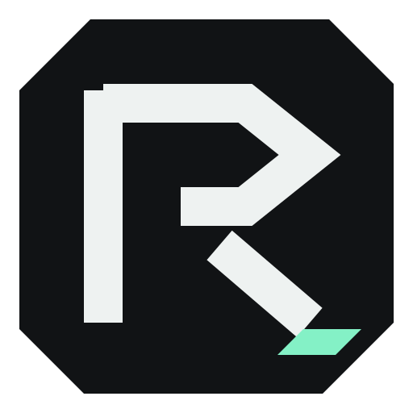

<div align="center">
  
  <h1>Ryou UI</h1>
  <p>Biblioteca visual en un archivo para scripts Luau de cliente Roblox.</p>
  <p><strong>14.0.0</strong> · Rama de revisión · Created by Ryou</p>
</div>

[Inicio rápido](docs/getting-started.md) · [English](docs/getting-started.en.md) · [API](docs/api-reference.md) · [Ejemplos](examples/) · [Cambios](CHANGELOG.md)

Ryou UI reúne ventanas, navegación lateral adaptable, controles de formulario y avisos. La paleta usa negro carbón con acento menta. El monograma de seis segmentos se dibuja dentro de Roblox y está disponible como [SVG editable](assets/ryou-mark.svg) y [PNG](assets/ryou-mark.png).

## Instalación rápida

Usa [RyouUI.lua](RyouUI.lua) como módulo del cliente. En Studio puedes copiar el archivo a un `ModuleScript` y cargarlo desde un `LocalScript` hermano. En hosts que proveen lectura HTTPS y compilación Luau, consulta el [cargador dinámico](examples/DynamicLoader.lua). Ambos puntos de entrada cargan el mismo archivo.

```lua
local UI = require(script.Parent:WaitForChild("RyouUI"))
local window = UI:CreateWindow({ Title = "Mi panel" })
local home = window:Tab({ Title = "Inicio", Icon = "home" })
home:Button({ Title = "Estado", Callback = function()
    window:Notify({ Type = "success", Title = "Panel activo" })
end })
```

## Documentación

| Para hacer esto | Consulta |
| --- | --- |
| Crear, mover y redimensionar | [Ventanas](docs/windows.md) |
| Navegar y organizar la interfaz | [Pestañas](docs/tabs.md) |
| Crear botones, toggles, sliders, inputs y colorpickers | [Componentes](docs/components.md) |
| Implementar búsqueda, listas dinámicas o selección múltiple | [Dropdowns](docs/dropdowns.md) |
| Elegir un glifo o cargar uno propio | [Catálogo gráfico](assets/icon-catalog.svg) y [guía de iconos](docs/icons.md) |
| Cambiar tema, tipografía y movimiento | [Temas](docs/themes.md), [Personalización](docs/customization.md) y [Animaciones](docs/animations.md) |
| Mostrar mensajes de estado | [Notificaciones](docs/notifications.md) |
| Instalar en un proyecto existente | [Integración](docs/integration.md) y [Migración desde V12](docs/migration.md) |
| Diagnosticar un problema | [Resolución de problemas](docs/troubleshooting.md) |

## Compatibilidad y pruebas

La biblioteca requiere servicios del cliente Roblox y acceso a `PlayerGui`. Luau CLI sirve para compilación y simulación de estado. La [prueba para Roblox](tests/Smoke.client.lua) se incluye para ejecutarla en **Play**. La revisión actual tiene verificación en CLI y quedan pendientes el renderizado, el tacto real en Android y las capturas de la interfaz.

Consulta [cómo contribuir](CONTRIBUTING.md) y la [revisión de procedencia](docs/provenance.md) antes de enviar recursos nuevos. La propuesta de licencia está pendiente de autorización.

**Created by Ryou**
